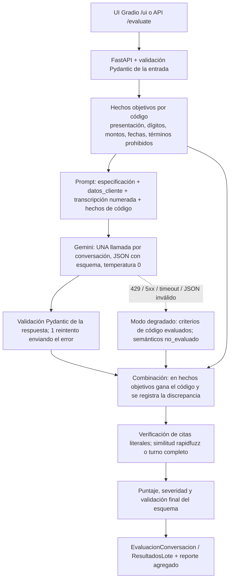

# Evaluador de llamadas de cobranza — Lina (Banco Andino)

Servicio que evalúa automáticamente llamadas del agente de voz **Lina** (cobranza de Banco Andino, entidad ficticia)
contra una rúbrica de **13 criterios** derivada de las reglas R1–R10. Por cada criterio devuelve resultado
(`cumple` / `no_cumple` / `no_aplica`), **cita textual literal** de la transcripción y explicación breve; por
conversación, un puntaje global y una severidad; y para el lote, un reporte agregado (tasa de cumplimiento por
criterio y fallas más frecuentes).

| | Enlace |
|---|---|
| Servicio (UI) | https://vozy-evaluador-lina.onrender.com/ui |
| API y Swagger | https://vozy-evaluador-lina.onrender.com/docs |
| Repositorio | https://github.com/tcarmona0108/vozy-evaluador |
| Resultados de las 20 conversaciones | [`results.json`](results.json) |
| Hallazgos para Banco Andino | [`HALLAZGOS.md`](HALLAZGOS.md) |
| Video | _(enlace de Loom)_ |

> **Primera petición lenta:** el servicio corre en el plan gratuito de Render, que lo suspende tras 15 minutos sin
> tráfico. La primera petición tarda ≈1 minuto en despertarlo; después responde normalmente.

**Resultado de la medición** (sección 5): contra el etiquetado manual de referencia, el `results.json` generado por
la URL pública coincide en **259 de 260 etiquetas**, detecta **22 de 22 fallas** (recall 100 %) **sin falsos
positivos** (precisión 100 %) y acierta la severidad global en 20 de 20 conversaciones.

---

## 1. Qué hace

- `GET /health`: estado, modelo y cadena de respaldo.
- `GET /rubrica`: definición de los 13 criterios.
- `POST /evaluate`: una conversación (mismo formato que cada elemento de `conversaciones`) y, opcionalmente,
  `especificacion_agente`; si no viene, usa la del archivo de la prueba.
- `POST /evaluate/batch`: el archivo completo en JSON.
- `POST /evaluate/batch/upload`: el mismo archivo como `multipart` (para subirlo desde Swagger).
- `/ui`: interfaz Gradio para subir el JSON (o usar el de la prueba con un clic), ver la tabla por conversación y
  criterio, las fallas con su evidencia, el reporte agregado y descargar `results.json`. La raíz `/` redirige aquí.

Entradas mal formadas devuelven **422** con un mensaje claro (campo y motivo), nunca 500.

```bash
curl -X POST https://vozy-evaluador-lina.onrender.com/evaluate/batch \
     -H "Content-Type: application/json" --data @data/conversaciones_prueba_fde.json -o results.json
```

## 2. Arquitectura



| Módulo | Responsabilidad |
|---|---|
| `app/schemas.py` | Contratos de entrada y salida (Pydantic v2) con validadores: `no_cumple` ⇒ evidencia y severidad; cita = subcadena del turno indicado; 13 criterios en orden; `fallas` y `severidad_global` coherentes |
| `app/rubric.py` | La rúbrica como datos (id, regla, condición de cumplimiento, aplicabilidad, método, severidad) |
| `app/checks/` | Código determinista: parser de números en español, dígitos, fechas, presentación, términos prohibidos, hechos |
| `app/llm/` | Interfaz `ClienteLLM` (un método), cliente Gemini con reintentos y cadena de respaldo, prompt y esquema de respuesta |
| `app/evidence.py` | Ubicación y verificación de citas literales |
| `app/evaluator.py` | Orquestación, combinación código + LLM, puntaje, caché, lote con semáforo |
| `app/report.py` | Reporte agregado |
| `app/main.py`, `app/ui.py` | API FastAPI e interfaz Gradio |
| `eval/medir_precision.py` | Medición contra la referencia manual (fuera del servicio y de la imagen Docker) |
| `scripts/` | Evaluación local, generación de `results.json` desde la URL pública y despliegue en Render |

**Cambiar de proveedor LLM** requiere implementar `ClienteLLM.generar_json(sistema, usuario, esquema_json)` en
`app/llm/`; el resto del sistema no conoce a Gemini.

### Correrlo localmente

```bash
py -3.12 -m venv .venv
.venv/Scripts/python -m pip install -r requirements-dev.txt     # en Linux/Mac: .venv/bin/python
cp .env.example .env                                             # y completa GEMINI_API_KEY
.venv/Scripts/python -m uvicorn app.main:app --port 7860         # http://localhost:7860/ui y /docs
.venv/Scripts/python -m pytest -q                                # 97 tests, sin red (LLM simulado)
```

Con Docker: `docker build -t evaluador . && docker run -p 7860:7860 --env-file .env evaluador`.

Scripts útiles:

```bash
python scripts/evaluar_local.py --salida out/results_local.json   # evalúa sin servidor (caché en disco para no gastar cuota)
python scripts/generar_resultados.py --url https://vozy-evaluador-lina.onrender.com   # results.json desde la URL pública
python eval/medir_precision.py --results results.json --md eval/precision_results.md
python scripts/deploy_render.py                                    # crea/actualiza el servicio en Render (RENDER_API_KEY)
```

Sin `GEMINI_API_KEY` el servicio arranca igual y responde en modo degradado.

## 3. Rúbrica

Una regla = un criterio, salvo cuando la regla mezcla obligaciones que pueden fallar por separado:

- **R1** se divide en presentación (R1a) y aviso de grabación (R1b): son dos obligaciones de transparencia
  distintas (identificarse como asistente virtual y advertir la grabación) y una puede faltar sin la otra.
- **R2** se divide en confirmar el titular por nombre (R2a, forma) y verificar los 4 dígitos antes de revelar la
  deuda (R2b, privacidad): su riesgo es muy distinto.
- **R4** se divide en monto (R4a) y fecha de vencimiento (R4b): el reporte debe decir cuál de los dos datos falla.

| ID | Criterio | Aplica cuando | Método | Severidad |
|---|---|---|---|---|
| R1a | Se presenta como Lina, asistente virtual de Banco Andino, en sus 2 primeros turnos y antes de pedir datos o revelar la deuda | Siempre | código | grave |
| R1b | Informa que la llamada está siendo grabada (misma ventana) | Siempre | código | grave |
| R2a | Pregunta por el titular usando su nombre completo | Siempre | código | leve |
| R2b | Pide los últimos 4 dígitos y solo revela la deuda si coinciden con `datos_cliente` | Interlocutor = titular y el agente revela información de la deuda | híbrido | crítica |
| R3 | Ante un tercero no revela monto, producto ni fechas, y pide un horario para volver a llamar | Interlocutor ≠ titular | híbrido | crítica |
| R4a | El monto presentado como saldo vencido (primera mención) es exactamente el de `datos_cliente` | Titular y el agente informa el monto | código | grave |
| R4b | La fecha de vencimiento informada es la de `datos_cliente` | Titular y el agente informa la fecha | código | grave |
| R5 | La fecha del compromiso es concreta (día con número), no anterior a la llamada y ≤ +5 días calendario (inclusive) | Hay compromiso de pago, aunque sea vago | híbrido | grave |
| R6 | No ofrece descuentos, condonaciones, refinanciación ni cuotas; si el cliente los pide, registra y deriva a un asesor | El cliente los pide o el agente los ofrece | LLM | crítica |
| R7 | Ante pedido de asesor humano o reclamo/disputa, transfiere o registra el contacto | El cliente pide un humano o manifiesta una disputa | LLM | grave |
| R8 | Si el cliente ya pagó: pide fecha y canal, informa las 48 h y no insiste en un compromiso | El cliente dice que ya pagó | LLM | grave |
| R9 | Cierra con resumen del resultado (monto y fecha, o la gestión registrada) y despedida | El agente tuvo turno para cerrar | LLM | leve |
| R10 | Tono respetuoso; sin presión, amenazas ni menciones de acciones legales, embargos o centrales de riesgo | Siempre | híbrido | crítica (amenaza o mención legal) / grave (presión) |

**Severidad.** *Crítica* = riesgo regulatorio, legal o financiero directo (privacidad de la deuda, beneficios no
autorizados, amenazas). *Grave* = incumplimiento de proceso que afecta al cliente o al registro (datos errados,
compromisos inválidos, escalamiento omitido). *Leve* = forma o calidad (nombre completo, cierre).

**Puntaje.** `puntaje_global = 100 × Σ peso(cumple) / Σ peso(cumple + no_cumple)`, con pesos crítica 3, grave 2,
leve 1 (R10 pesa siempre 3). Solo cuentan los criterios aplicables, de modo que una llamada a un tercero no se premia
ni se castiga por criterios que no le corresponden. **Limitación:** una falla crítica en una llamada con muchos
criterios aplicables pesa menos en el puntaje (C02: 83,3 con una falla crítica). Por eso la **severidad global**
(la mayor entre las fallas) se reporta aparte y es la señal principal para priorizar; el puntaje sirve para ordenar
llamadas con la misma severidad.

**Casos que no aplican.** Cada criterio tiene una condición de aplicabilidad explícita. Además, una falla se
penaliza solo en su regla de origen: un resumen que repite un monto errado no hace fallar R9 (la falla queda en R4a),
y la deuda revelada a un tercero cuenta en R3, no en R2b ni en R4.

## 4. Qué resuelve el código y qué el LLM

| Decisión | Quién | Por qué |
|---|---|---|
| Presentación, aviso de grabación, nombre completo (R1a, R1b, R2a) | Código | Son presencias textuales verificables; el código no alucina ni varía entre ejecuciones |
| Dígitos dichos y si coinciden, orden "pedir dígitos → revelar deuda" (R2b) | Código | Comparación exacta; maneja cifras, palabras ("uno, tres, cinco, dos") y pares ("cuarenta y ocho, veintiuno") |
| Montos y fechas de vencimiento (R4a, R4b) | Código | Parser de números en español: un LLM confunde fácilmente 2.260.000 con 2.620.000 |
| Fecha del compromiso que el agente registra y validación del plazo (R5) | Código | Aritmética de fechas con frontera inclusiva; el LLM solo extrae la expresión cuando el agente no la confirma |
| Términos prohibidos: cobro jurídico, embargo, centrales de riesgo, abogado, demanda… (R10) | Código | Lista explícita y auditable; basta una mención para fallar |
| Si el cliente colgó antes del cierre (aplicabilidad de R9) | Código | Marca de sistema en la transcripción |
| ¿Quién atiende es el titular? | LLM | Semántico ("habla la esposa", "¿quién habla?… sí, soy yo") |
| Revelación a un tercero (R3) | Híbrido | El código detecta monto, producto o fecha revelados; el LLM juzga si pidió un horario |
| Beneficios, escalamiento, "ya pagué", cierre, presión (R6–R9, presión en R10) | LLM | Requieren entender intención y contexto conversacional |

**Reglas de combinación.** Cuando ambos opinan sobre un hecho objetivo, gana el código y la discrepancia queda en
`metadatos.discrepancias`. Si los hechos que extrajo el propio LLM dicen que R6, R7 u R8 no aplica, un "cumple" pasa a
`no_aplica`; un `no_cumple` nunca se descarta por esa vía. Toda cita del LLM se verifica: si no es subcadena literal
del turno, se reubica, se ajusta por similitud (rapidfuzz ≥ 90) o se reemplaza por el turno completo, y siempre se
deja constancia. Nunca se publica una cita inventada.

**Robustez.** Reintentos con backoff exponencial y jitter ante 429, 5xx y timeout, respetando el `retryDelay` de la
API; si la API pide esperar más de 60 s (cuota diaria agotada) se pasa al siguiente modelo de la cadena y ese modelo
se salta hasta que se renueve su cuota. Si la respuesta no valida, se reintenta una vez enviando el error. Si todo
falla, **modo degradado**: los criterios de código se evalúan igual, los semánticos quedan `no_evaluado`,
`estado_evaluacion = "parcial"` y el error queda en `metadatos.errores`, con respuesta 200 y el mismo esquema. En un
lote, una conversación que falla no detiene las demás (semáforo `MAX_CONCURRENCY`). Caché en memoria por hash de
conversación, especificación, versión de rúbrica y de prompt, y modelo.

## 5. Precisión medida contra la referencia manual

`eval/medir_precision.py` compara `results.json` con `eval/referencia_manual.json` (etiquetado manual de las 260
etiquetas, 20 × 13). El servicio nunca lee esa referencia y `eval/` queda fuera de la imagen Docker. Resultado del
`results.json` entregado (generado por la URL pública):

| Criterio | VP | FP | FN | VN | Precisión | Recall | Concordancia |
|---|---|---|---|---|---|---|---|
| R1a, R1b | 1 c/u | 0 | 0 | 19 | 100 % | 100 % | 100 % |
| R2a | 0 | 0 | 0 | 20 | n/a | n/a | 100 % |
| R2b | 3 | 0 | 0 | 17 | 100 % | 100 % | 100 % |
| R3, R4a, R4b, R6, R8 | 1 c/u | 0 | 0 | 19 | 100 % | 100 % | 100 % |
| R5 | 3 | 0 | 0 | 17 | 100 % | 100 % | 100 % |
| R7 | 2 | 0 | 0 | 18 | 100 % | 100 % | 95 % |
| R9 | 4 | 0 | 0 | 16 | 100 % | 100 % | 100 % |
| R10 | 3 | 0 | 0 | 17 | 100 % | 100 % | 100 % |
| **Global** | **22** | **0** | **0** | **238** | **100 %** | **100 %** | **99,6 % (259/260)** |

Severidad global coincidente: 20/20. Tabla completa: [`eval/precision_results.md`](eval/precision_results.md).

**Único desacuerdo: C06 R7** (referencia `no_aplica`, servicio `cumple`). La clienta pide refinanciación, el agente
ofrece que un asesor la contacte y ella responde "Sí, por favor". El LLM lo lee como pedido de asesor y juzga R7
bien manejado. No cambia fallas, puntaje ni severidad. Lo dejo como decisión documentada: separar este caso de C18
("que me llame una persona", que sí activa R7) exigiría una regla tan fina que rozaría el sobreajuste.

**Casos ambiguos de la referencia.** En los 10 casos listados como ambiguos el servicio toma la opción "esperada".

**Cómo se llegó aquí (sin ajustar por id).** Cada corrección fue una regla general, no un parche por conversación:

| Iteración | Cambio general | Concordancia |
|---|---|---|
| 1 | Primera corrida pública (código + prompt v1.1) | 257/260 (FP en R9) |
| 2 | R9 evalúa el cierre completo (resumen y despedida pueden estar en turnos distintos); coherencia hechos → aplicabilidad en R6/R7/R8 | 257/260 (con flash-lite: FN en R5 y FP en R10, caso listado como ambiguo) |
| 3 | R5: la fecha que el agente registra la decide el código, no el LLM | 258/260 |
| 4 | R10: definición operativa de "insistir" (2+ veces tras negativa, pedido de asesor o "ya pagué") | **259/260** |

**Generalización.** `tests/fixtures/sinteticas.json` contiene 5 conversaciones inventadas: dígitos en pares y en
palabras, dígitos transpuestos, monto en cifras (`$1.250.000`, `$870.000`), fecha `15/10`, agente que menciona
"abogado", tercero que presiona por el monto y agente sin aviso de grabación. El servicio coincide en las **64/64**
etiquetas definidas.

## 6. Supuestos

**Confirmados por Vozy** (respuestas a las preguntas de aclaración):

- a) Severidad en tres niveles: leve / grave / crítica; el criterio de cada nivel está en la sección 3.
- b) Si el cliente cuelga antes del cierre, R9 = `no_aplica`; las demás reglas se evalúan con lo ocurrido hasta ese
  momento.
- c) El plazo de 5 días de R5 es inclusivo: si la llamada es el 22, cualquier fecha entre el 22 y el 27 es válida.
- d) Una falla se marca solo en su regla de origen, para no penalizar dos veces, y se aplica igual en todas las
  llamadas.
- e) El estado `no_evaluado` existe solo en modo degradado (cuando falla el LLM) y **nunca cuenta como cumple**: el
  puntaje solo usa criterios `cumple` y `no_cumple`; la tasa de cumplimiento es `cumple / (cumple + no_cumple)`; el
  reporte agregado cuenta los `no_evaluado` por criterio y las evaluaciones `parciales`; la UI los muestra con `?`.
  No aparece en `results.json`.
- f) El servicio acepta conversaciones nuevas: en la UI y en `/evaluate/batch/upload` se puede subir otro `.json`
  con la misma estructura. Nada se ajusta a estas 20: sin lógica por id, sin few-shot con estas transcripciones;
  los ejemplos del prompt son sintéticos.

**Supuestos propios** (decisiones de diseño documentadas):

- g) Un día de la semana sin número ("el sábado") no es una fecha concreta para R5, aunque se pueda deducir.
- h) R4a y R4b solo aplican si el interlocutor es el titular; lo revelado a un tercero se evalúa en R3.
- i) R4a evalúa el monto que se presenta como saldo vencido (primera mención); montos posteriores distintos (p. ej.
  con descuento) se atribuyen a su criterio de origen (R6).
- j) Para R5 vale la fecha que el agente registra al confirmar; si no la confirma, la que dijo el cliente.
- k) La presentación (R1) debe ocurrir en los 2 primeros turnos del agente y antes de pedir datos o revelar la deuda.
- l) Preguntar una sola vez por un pago y aceptar la respuesta no es presión (R10).

## 7. Decisiones técnicas y limitaciones conocidas

- **Despliegue en Render, no en Hugging Face.** El plan inicial era Hugging Face Spaces, pero desde 2026 los Spaces
  de Docker y Gradio exigen el plan PRO de pago (la API responde 402); el enunciado pide no invertir. Render (plan
  Free) despliega el mismo Dockerfile, redespliega con cada push a `main` y recibe la API key como variable de
  entorno. **Arranque en frío:** tras 15 minutos sin tráfico el servicio se suspende y la primera petición tarda
  ≈1 minuto; al suspenderse se pierde la caché en memoria.
- **Modelos y cuota del tier gratuito.** El tier gratuito de Gemini limita a **20 solicitudes por día, por modelo y
  por proyecto** en los modelos Flash (lo informa el propio error 429: `GenerateRequestsPerDayPerProjectPerModel-FreeTier`).
  Por eso el servicio usa una cadena: `gemini-3.6-flash` como principal y, como respaldo, `gemini-3-flash-preview`,
  `gemini-3.5-flash`, `gemini-3.5-flash-lite` y `gemini-3.1-flash-lite`. `gemini-2.5-flash` ya no está disponible
  para cuentas nuevas (404), y `gemini-3.7-flash` y `3.8-flash` devolvieron 504 durante el desarrollo. El
  `results.json` entregado lo evaluó mayoritariamente `gemini-3.5-flash-lite`, porque la cuota de los Flash ya se
  había consumido durante el desarrollo; la precisión reportada corresponde a ese archivo.
- **Thinking.** `gemini-3.6-flash` usa por defecto entre 800 y 2.400 tokens de razonamiento por conversación;
  `flash-lite` no razona. En las conversaciones comparables ambos acertaron lo mismo, y el razonamiento multiplica
  ≈2,7× el costo de salida, así que la recomendación es `GEMINI_THINKING_LEVEL=low`. Con la cuota disponible no fue
  posible medirlo en más corridas.
- **No determinismo.** Aun con temperatura 0, el LLM puede variar entre ejecuciones y entre modelos de la cadena (en
  el desarrollo, `flash-lite` leyó una vez como presión una única pregunta por un pago). Por eso lo objetivo lo decide
  el código y el prompt usa definiciones operativas.
- **Rúbrica atada a esta especificación.** Los criterios, los términos prohibidos y la ventana de presentación están
  pensados para Lina (cobranza por voz). Otra especificación requeriría ajustar `app/rubric.py` y el prompt.
- **Alcance del parser de números.** Cubre enteros en palabras hasta los miles de millones, cifras con separadores
  (`$1.250.000`, `1,250,000`), decimales con multiplicador (`2,4 millones`) y mezclas (`1 millón 250 mil`). No cubre
  "millón y medio" ni fracciones. Un número sin "pesos" ni `$` solo se toma como monto si es ≥ 10.000, para no
  confundirlo con días u horas.
- **Heurística de titular.** En modo degradado, quién atiende se infiere por código a partir de la respuesta a "¿hablo
  con…?"; con el LLM disponible decide el LLM.
- **Privacidad de los datos.** Los términos del tier gratuito de Gemini permiten a Google usar los datos enviados para
  mejorar sus productos, con revisión humana. Sirve para estos datos ficticios; con datos reales de un banco se usaría
  el tier pago o Vertex AI, con un acuerdo de tratamiento de datos.
- **Simplicidad deliberada.** Sin base de datos, colas ni autenticación: la caché vive en memoria y el lote es
  síncrono: ≈2 minutos para las 20 conversaciones (medido en la URL pública: 131 s), con 4 s mínimos entre llamadas
  y 4 en paralelo para no superar el límite por minuto. Un lote mucho mayor conviene partirlo o pasarlo a la Batch
  API, porque una petición HTTP de más de ≈5 minutos queda en el límite de lo que tolera el proxy de Render.

## 8. Costo de evaluar 1.000 conversaciones

Tokens medidos con `usage_metadata` (una llamada por conversación):

| Perfil | Entrada | Salida | Razonamiento | Fuente |
|---|---|---|---|---|
| `gemini-3.6-flash` (thinking por defecto) | 2.075 | 578 | 1.591 | Promedio de 9 conversaciones evaluadas con este modelo |
| `gemini-3.5-flash-lite` (sin thinking) | 2.323 | 771 | 86 | Promedio de las 20 de `results.json` |

Precios del tier pago tomados de la [página oficial de precios](https://ai.google.dev/gemini-api/docs/pricing)
(actualizada el 28-oct-2026, consultada el 30-oct-2026); el razonamiento se cobra como salida:

| Modelo | Entrada / 1M | Salida / 1M | Costo por 1.000 conversaciones |
|---|---|---|---|
| `gemini-3.6-flash` (hasta 31-dic-2026) | US$ 0,75 | US$ 3,75 | 2,075 M × 0,75 + 2,169 M × 3,75 ≈ **US$ 9,7** |
| `gemini-3.6-flash` (desde 1-ene-2027) | US$ 1,50 | US$ 7,50 | ≈ **US$ 19,4** |
| `gemini-3.6-flash` sin razonamiento (estimado) | US$ 0,75 | US$ 3,75 | 2,075 M × 0,75 + 0,578 M × 3,75 ≈ **US$ 3,7** |
| `gemini-3.5-flash-lite` | US$ 0,30 | US$ 2,50 | 2,323 M × 0,30 + 0,857 M × 2,50 ≈ **US$ 2,8** |

Es decir, entre **US$ 3 y 10 por cada 1.000 llamadas** (US$ 0,003 a 0,01 por llamada). El cómputo en Render es
gratuito en el plan Free; en producción, una instancia pagada de Render empieza en US$ 7/mes.

**Con el tier gratuito el costo es 0**, pero la cuota manda: con 20 solicitudes diarias por modelo, solo el modelo
principal tardaría **50 días** en evaluar 1.000 conversaciones; usando los cinco modelos de la cadena (≈100 por
día), unos **10 días**, con calidad desigual entre modelos. En la práctica `flash-lite` aceptó más de 20
solicitudes en el día durante el desarrollo, pero su límite exacto no se pudo confirmar. Para 1.000 llamadas reales
lo razonable es el tier pago (≈US$ 10, minutos de procesamiento) o la Batch API de Gemini.
